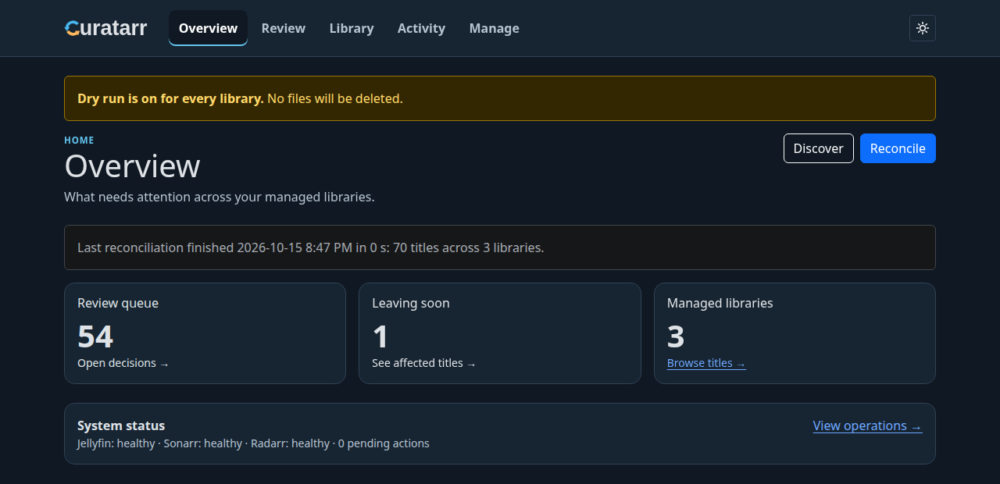
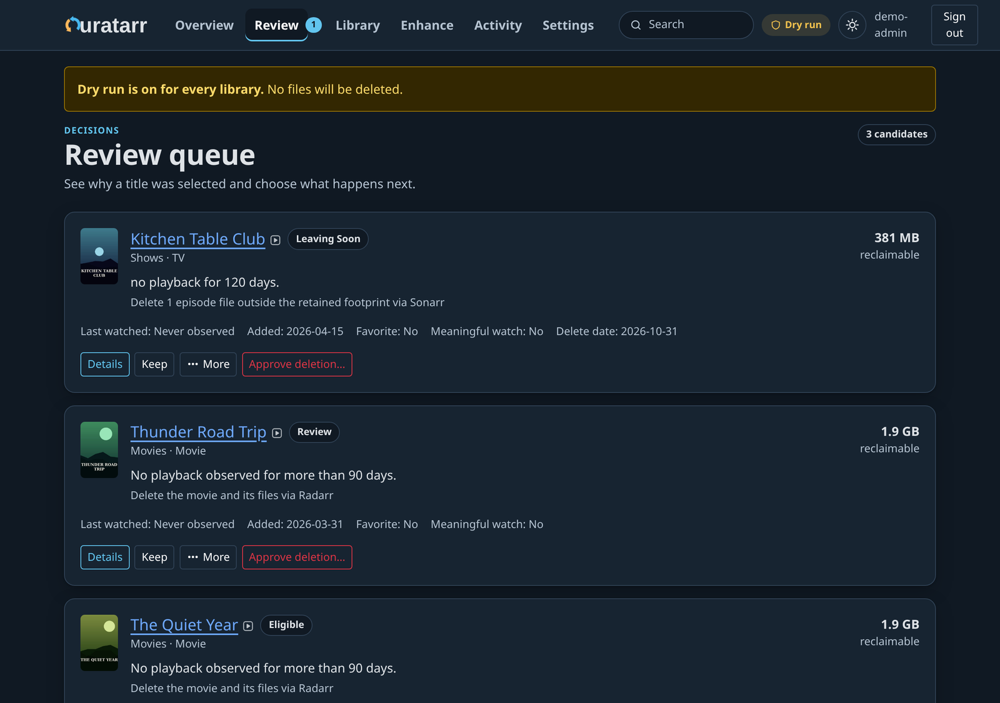
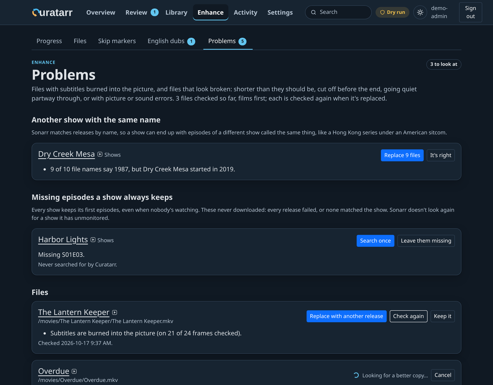
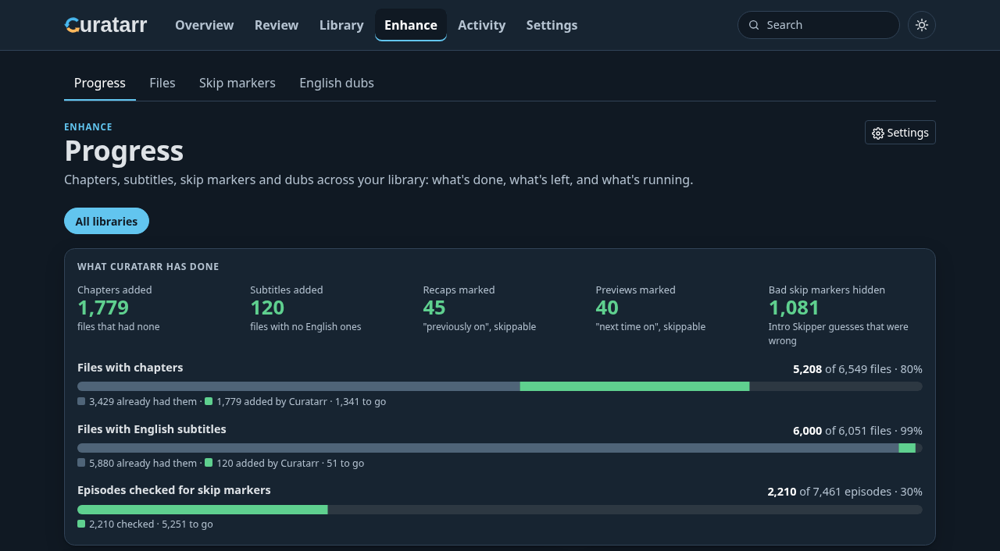
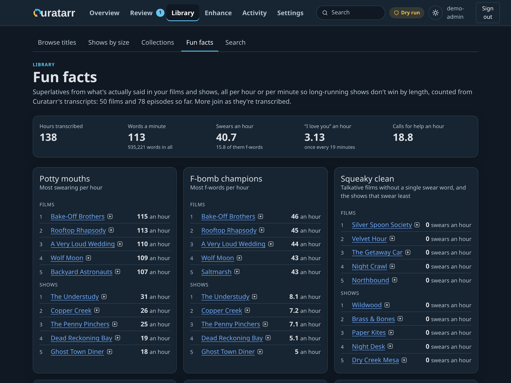
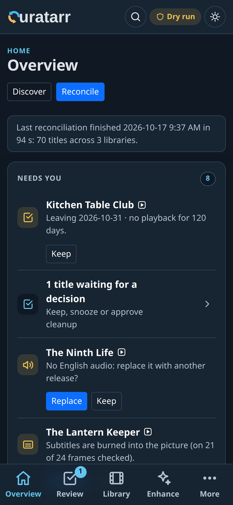

<p align="center">
  
</p>

<h1 align="center">Curatarr</h1>

<p align="center">
  <strong>The caretaker your Jellyfin library has been missing.</strong><br>
  It learns what your household actually watches, keeps the disk from filling up, fetches the next season before anyone asks, and fixes the downloads that came out wrong.
</p>

<p align="center">
  <a href="#feature-list">Features</a> ·
  <a href="docs/INSTALL.md">Install</a> ·
  <a href="docs/FEATURES.md">How it works</a> ·
  <a href="docs/API.md">API</a> ·
  <a href="CHANGELOG.md">Changelog</a> ·
  <a href="docs/DEVELOPMENT.md">Development</a>
</p>

---

## What you need

| | |
|---|---|
| **Jellyfin** | Required. Curatarr reads who watched what, and you sign in with your Jellyfin account. |
| **Sonarr** and/or **Radarr** | At least one. With Sonarr, Curatarr looks after your TV shows; with Radarr, your films; with both, everything. |

That's all you need to get started. Add these when you want more:

| Optional | Unlocks |
|---|---|
| Jellyfin **Webhook** plugin | Instant reactions to playback (otherwise Curatarr catches up hourly) |
| The **Curatarr plugin for Jellyfin** ([jellyfin-plugin](jellyfin-plugin/README.md)) | Delete in any Jellyfin app marks a title Leaving Soon instead of deleting its files, each device plays the copy and audio track it can play without converting, and each account can have posters (and other pictures) of its own |
| **FFmpeg** and **MKVToolNix** | Chapters, English-dub checks, file problem checks |
| **Local AI**: Whisper (installed with the `chapters` extra) and **Ollama** with a model (e.g. `qwen3:14b`), ideally on an NVIDIA GPU | Smart Chapters, subtitles, recap and preview detection, Fun facts, search by what was said |
| Jellyfin **Intro Skipper** plugin | Skip buttons for recaps and previews, clean-up of bad skip markers, and knowing where a film's credits start |
| **Seerr** (or Jellyseerr/Overseerr) | Requested titles are kept until whoever asked has watched them |

Everything runs on your own server. No cloud service, no account, no tracking. Free and open source (MIT).



## Why you'll want it

### 💾 Never run out of space, and never lose what someone's in the middle of
When a disk runs low, Curatarr picks the titles nobody has touched for longest and puts them on a **Leaving Soon** shelf: a red countdown tag on the poster in Jellyfin ("14 DAYS LEFT"), and a Leaving Soon collection everyone can browse. Anyone who presses play saves it. New arrivals get a grace period, favourites go to the back of the line, and you can keep, snooze or protect anything for good.

It knows what your household cares about, too:

- **Asked for it in Seerr?** It stays until whoever asked has watched it.
- **The comfort rewatches** go to the back of the line without anyone pressing Keep.
- **What an import list dragged in** and nobody played goes first.
- **Halloween films stay through October** (and Christmas ones through December), and can even come back before their season.
- **Shrink instead of delete:** swap a 25 GB copy of a film you keep for a 6 GB one, only if one exists.
- **A disk forecast** says when you'll run low at this week's pace, and what would go first.

#### How Leaving Soon works

1. **A title is picked**: the disk is running low and nobody has touched it for longest, or you chose **Remove** in Curatarr, or someone pressed **Delete** in a Jellyfin app (with the [Curatarr plugin for Jellyfin](jellyfin-plugin/README.md)).
2. **Everyone can see it's going.** For the notice period (14 days by default) its poster, home-screen card and backdrop in Jellyfin count down the days, and it joins a **Leaving Soon** collection.
3. **Anyone can save it** by pressing play. You can also **Keep** it, snooze it or protect it for good in Curatarr. The original pictures come back within seconds.
4. **Otherwise it goes** through Radarr or Sonarr when the notice ends, so nothing downloads it straight back. In dry run (where every library starts), Curatarr only records what it would have removed.




### 📺 The next episode is already there
Finish an episode and Curatarr asks Sonarr for the rest of the season, and the next one, before anyone has to. The episodes people are about to watch get their chapters, subtitles and skip markers first, and a film stopped in its end credits counts as watched, so Continue Watching holds only what's really unfinished. Shows nobody continued stop downloading. Every show keeps its first few episodes, so there's always something to start on; if one of those never arrived, Curatarr says so and searches once at a click.

### 🛠️ Bad downloads, caught and fixed
Curatarr checks every file so you don't find out halfway through a film:

- **Subtitles burned into the picture** that can't be turned off
- **Incomplete downloads** where the picture stops before the end, and files much shorter than they should be
- **The wrong show entirely**: a 1987 namesake filed under your 2019 series
- **No English audio** on a film that was sold as an English dub
- **Wrong episodes**: a file whose dialogue matches a different episode's summary
- **Misfiled episodes**: an episode Sonarr filed in another's slot is moved back where it belongs

Each problem is listed with a button to fix it, and once you trust a kind of fix, Settings → Automatic lets Curatarr do it by itself whenever it can be sure. Every **Replace** first checks that a better copy actually exists; only then does it blocklist the bad release, delete the file and grab the new one. If nothing better is out there, it keeps what you have and tells you so.



### ✨ Every file nicer to watch
- **Chapters** for files that have none, named from what's actually said (*Smart Chapters*, local Whisper + Ollama), or evenly spaced at scene changes.
- **English subtitles** made from the soundtrack, for files that have none, or only picture subtitles a Roku can't draw.
- **Skip "Previously on…" and "Next time on…"** with Jellyfin's own Skip button.
- **Better skip markers**: Intro Skipper guesses that are plainly wrong are hidden, each one undoable.
- **The right audio first**: tracks labelled in the wrong language are relabelled, and the real English track becomes the default.
- **Audio every TV can play**: films and episodes with DTS, TrueHD or FLAC sound get an AC3 copy beside the original, so a Roku or TV plays them directly instead of stumbling over conversion.
- **Audio for web browsers**: Chrome and Firefox can't play AC3 or DTS, so files browser viewers are about to watch get a stereo AAC track, and the Curatarr plugin points browsers at it. TVs keep their surround track.
- **The film's own soundtrack first**: when a release makes the director's commentary or the audio description the default track, the film's soundtrack becomes the default instead.
- **Seeking that works on Roku**: files whose seek index sits where Roku players don't look are rebuilt (nothing re-encoded), so skipping ahead doesn't start the episode over.
- **Posters in your language**: a new release that arrived with only a foreign poster gets one in your language once TMDB has it.

The picture is never re-encoded; the only thing ever encoded is an extra audio track, with the original kept beside it. Chapters and subtitles wait until you switch them on. The checks run from the start, but anything that would change a file waits for your OK until you make that fix automatic.



### 🖼️ Posters starring your household
Give any title your own poster: upload one, or drop a folder of pictures and Curatarr matches each to its title. Curatarr can even write the prompts for an image-making AI to make them, in batches, with the two of you cast as the leads of your favourite films. With the Curatarr plugin, a poster can be for chosen accounts only: you see yourselves on the Roku, the kids' account sees the usual art. Each title's original art is handed to the AI as a reference, so the new pictures keep the film's feel. And favourite ribbons put a gold star and Sam's face on the posters of what someone else in the house loves. The original is always kept, one click away, and the **Gallery** lays every picture out, title by title, with a slideshow for showing them off.

### 🎉 Fun facts the whole household will argue about
Which film swears most per hour? Which show says "I love you" most? Who talks longest without a pause, and what's each show's catchphrase? **Fun facts** ranks your library by what's actually said in it, all per hour or per minute so a long-running show doesn't win just by being long. Handy, too, for finding the films that don't swear at all when the kids are around.



### 🔎 Find the episode where someone said *that line*
Search every transcript for a quote or a topic and jump straight to the episode, with the lines around it and the timestamp. Put words in "quotes" for the exact line; matches are highlighted.

### 📱 On your phone, for the whole household
Everything works on a phone. Household members sign in with their own Jellyfin accounts and can browse, search and say *Keep*; only administrators can approve deletions or change settings.

<p align="center"></p>

## Feature list

Everything Curatarr does, at a glance. **On** means it works as soon as Curatarr is connected; the rest are a switch away in Settings. [How it works](docs/FEATURES.md) has the detail behind each one.

### 💾 Space and cleanup

| Feature | What it does | Default |
|---|---|---|
| [Leaving Soon](docs/FEATURES.md#cleanup-is-driven-by-free-space) | Titles about to go count down on their poster, home-screen card and backdrop in Jellyfin, and gather in a Leaving Soon collection. Playing any of it saves it. | **On** |
| [Free-space cleanup](docs/FEATURES.md#cleanup-is-driven-by-free-space) | When a disk runs low, the titles nobody has touched for longest go first, only as many as needed. | Set a disk to watch |
| [Household choices](docs/FEATURES.md#what-the-households-choices-change) | Seerr requests stay until whoever asked has watched; favourites and rewatches go to the back of the line; what an import list added goes first. | **On** |
| [Seasonal shelves](docs/FEATURES.md#what-the-households-choices-change) | Halloween films stay through October, Christmas ones through December; optionally they come back for their season. | **On** (return: Off) |
| [Leave after watched](docs/FEATURES.md#leave-after-watched-and-never-compress) | One last watch, then it goes: Leaving Soon starts once it's been watched. Also settable from a remote through the API. | Per title |
| [Compression first](docs/FEATURES.md#compression-first) | While Tdarr or another transcoder still has work queued, low space waits for it instead of marking titles Leaving Soon. | Off |
| [Never compress](docs/FEATURES.md#leave-after-watched-and-never-compress) | Lists the files Tdarr or another transcoder must leave alone: ones you flag, and favourites if you like. | Per title, season or episode |
| [Shrink instead of delete](docs/FEATURES.md#shrink-instead-of-delete) | Swaps a big copy of a film you keep for one half the size, only if one exists. | One click |
| [Free up space](docs/FEATURES.md#tv-one-season-ahead) | Every film and show by what removing it would free, with who has watched it. | **On** |
| [Disk forecast](docs/FEATURES.md#disk-forecast) | When each disk runs low at this week's pace, and what would go first. | **On** |
| [Dry run](docs/FEATURES.md#before-anything-is-deleted) | Shows what would be removed, and why, without removing anything. | **On** for every library |
| [Delete in any Jellyfin app](jellyfin-plugin/README.md) | Marks a film or show Leaving Soon instead of deleting its files behind Radarr's and Sonarr's backs. | With the plugin |

### 📺 What to watch next

| Feature | What it does | Default |
|---|---|---|
| [One season ahead](docs/FEATURES.md#tv-one-season-ahead) | Finish an episode and the rest of the season, and the next, are requested from Sonarr. Shows nobody continued stop downloading. | **On** |
| [Always something to start](docs/FEATURES.md#tv-one-season-ahead) | Every show keeps its first few episodes; ones that never arrived are searched for once. | **On** |
| [What's next is ready first](docs/FEATURES.md#continue-watching-and-whats-next) | The next episodes of shows people are watching get their chapters, subtitles and skip markers before the back catalogue. | **On** |
| [Finished at the credits](docs/FEATURES.md#continue-watching-and-whats-next) | Something stopped in its end credits, or after its last line with only the ending left, is marked watched, so it leaves Continue Watching. | **On** |
| [Collections and suggestions](docs/FEATURES.md#collections-and-suggestions) | The film series you have part of, and films ranked by how well they fit what the household favourites. | **On** |
| [Find Favorites](docs/FEATURES.md#collections-and-suggestions) | Someone favourites a film in a series, and the rest of the series is added to Radarr and searched for. | Off |

### 🛠️ Bad downloads, caught and fixed

| Feature | What it does | Default |
|---|---|---|
| [File problems](docs/FEATURES.md#problems-burned-in-subtitles-and-broken-files) | Burned-in subtitles, files cut short or cut off, decoding errors, films that go quiet. | **On** (asks first) |
| [The wrong show](docs/FEATURES.md#shows-that-are-another-show-with-the-same-name) | A namesake (a remake, a foreign show) filed under your series. | **On** (asks first) |
| [Misfiled episodes](docs/FEATURES.md#episodes-filed-under-the-wrong-episode) | An episode Sonarr filed in another's slot is moved back, when what's said in it agrees with its download's name. | **On** (asks first) |
| [English dubs](docs/FEATURES.md#english-dubs) | Listens to films sold as English dubs: relabels wrong tracks, makes real English the default, replaces ones with none. | **On** (asks first) |
| [Wrong episodes](docs/FEATURES.md#recaps-previews-and-skip-markers) | Flags an episode whose dialogue fits another episode's summary. Experimental. | Off |
| [Automatic fixes](docs/FEATURES.md#automatic-fixes) | The fixes above happen by themselves when Curatarr can be confident, each switchable. Until then, each problem waits on Problems with a button to fix it. | Off |
| [Replace checks first](docs/FEATURES.md#replace-checks-first) | A file is only deleted once a better copy is confirmed to exist. | Always |

### ✨ Every file nicer to watch

| Feature | What it does | Default |
|---|---|---|
| [Chapters](docs/FEATURES.md#chapters-and-subtitles) | Chapters for files that have none, named from what's said (local Whisper and Ollama) or spaced at scene changes. | Off until you choose |
| [Subtitles](docs/FEATURES.md#chapters-and-subtitles) | English subtitles from the soundtrack, for files with none, or with only picture subtitles a Roku can't draw. | Off until you choose |
| [Recaps and previews](docs/FEATURES.md#recaps-previews-and-skip-markers) | "Previously on…" and "Next time on…" get Jellyfin's Skip button. | With Intro Skipper |
| [Better skip markers](docs/FEATURES.md#recaps-previews-and-skip-markers) | Intro Skipper guesses that are plainly wrong are hidden, each undoable; films keep only their credits. | With Intro Skipper |
| [The film's own soundtrack first](docs/FEATURES.md#playing-smoothly-on-every-device) | A commentary or audio description set as the default track gives way to the film's soundtrack. | **On** (asks first) |
| [Custom posters](docs/FEATURES.md#custom-posters) | Your own poster for any title, and its wide tile, background, logo and banner, uploaded or picked up from a folder (or made by an AI from prompts Curatarr writes), with the originals kept to restore. | One click |
| [Posters for one account](docs/FEATURES.md#for-everyone-or-for-chosen-accounts) | A poster only chosen accounts see, in every app (Roku included); everyone else keeps the usual one. | With the plugin |
| [Favourite ribbons](docs/FEATURES.md#favourite-ribbons) | A gold band with a star and Sam's face on what someone favourited (and "★ Sam" on its page), shown to the accounts you choose; NEW for a week, "♥ Household favourite" for everyone's, and on favourite episodes too. | Off, with the plugin |
| [Make them with an AI](docs/FEATURES.md#make-them-with-an-ai) | Prompts in batches for an image-making AI agent, with each title's plot, original art for reference and file name, and your household cast as the leads where it suits. | One click |
| [Gallery](docs/FEATURES.md#gallery) | Every picture made, laid out to show people: a page per title (its background and logo, then its poster, wide tile and banner), full screen and a slideshow. | **On** |
| [Posters in your language](docs/FEATURES.md#collections-and-suggestions) | A new release that arrived with a foreign poster gets one in your language once TMDB has it. | **On** |

### ▶️ Plays smoothly everywhere

| Feature | What it does | Default |
|---|---|---|
| [The right copy and track for each device](docs/FEATURES.md#playing-smoothly-on-every-device) | Each player is pointed at the copy and audio track it plays as it is, instead of having Jellyfin convert. | With the plugin |
| [Audio for web browsers](docs/FEATURES.md#playing-smoothly-on-every-device) | A stereo AAC track beside AC3, E-AC3 and DTS, for the files browser viewers are about to watch. TVs keep their surround. | **On**, with the plugin |
| [Audio every TV plays](docs/FEATURES.md#playing-smoothly-on-every-device) | An AC3 copy beside DTS, TrueHD or FLAC, so Rokus and TVs don't stumble over conversion. | Off |
| [Seeking on Roku](docs/FEATURES.md#seeking-on-roku) | Files Roku can't seek in are rebuilt (nothing re-encoded), so skipping ahead doesn't start over. | **On** (asks first) |
| [Makes room for viewers](docs/FEATURES.md#sharing-the-machine-with-playback) | Measures CPU, GPU and who's watching, and backs off when someone starts a stream. | **On** |

### 🎉 Just for fun

| Feature | What it does | Default |
|---|---|---|
| [Search what was said](docs/FEATURES.md#search-what-was-said) | Find the episode where someone said *that line*, with the timestamp. | With transcripts |
| [Fun facts](docs/FEATURES.md#fun-facts) | Which film swears most per hour, which show says "I love you" most, each show's catchphrase. | With transcripts |

### 👥 For the whole household

| Feature | What it does | Default |
|---|---|---|
| [Jellyfin sign-in](docs/FEATURES.md#signing-in-and-who-sees-what) | Everyone signs in with their own Jellyfin account; household members can browse, search and say Keep, only administrators approve deletions. | **On** |
| Phone-friendly | Every page works on a phone, in light or dark. | **On** |
| [API and metrics](docs/API.md) | Status and counts for home dashboards, a read-only API key, and metrics. | **On** |

Nothing re-encodes the picture. The only thing ever encoded is an extra audio track (AAC or AC3), and the original is always kept beside it.

## Safe to point at your real library

Curatarr was built on a real 8,000-file library and is careful by design:

- **Dry run is on by default** for every library. Curatarr shows what it *would* remove and why, until you switch that off.
- **Deletions only go through Sonarr or Radarr**, after Curatarr rechecks playback, grace periods, the download queue and connection health. If anything can't be verified, nothing is deleted.
- **Replace never leaves you with nothing.** It confirms a better copy can be found before it deletes the one you have.
- **File edits never re-encode the picture.** Chapters and track flags are written in place with `mkvpropedit`. Removing language tracks, or adding an extra audio track (the one thing that encodes, and only that track), writes a copy that's checked before it replaces the original, which keeps every original track.
- **Everything is undoable or recorded.** Markers it hid can be restored, chapters it wrote can be removed (your originals are kept), and every action is in History with the reason.
- **It steps aside for viewers.** It measures CPU, GPU and who's watching, and backs off when someone starts a stream.

It's still a release candidate: [IMPLEMENTATION_STATUS.md](IMPLEMENTATION_STATUS.md) lists the known gaps.

## Install

| Your server | How | Guide |
|---|---|---|
| **Linux** (Debian, Ubuntu, Fedora, …) | Native install with systemd. Simplest, and the easiest way to use an NVIDIA GPU. | [Linux](docs/INSTALL.md#linux) |
| **Linux** with Docker | Docker Compose, with PostgreSQL included. | [Docker on Linux](docs/INSTALL.md#docker-on-linux) |
| **Windows 10 / 11** | Docker Desktop (WSL 2). | [Windows](docs/INSTALL.md#windows) |
| **macOS** | Docker Desktop, following the Windows steps in Terminal. Not regularly tested; the AI features run on the CPU. | [Windows](docs/INSTALL.md#windows) |

Quick start on Linux:

```bash
git clone https://github.com/Copas/Curatarr.git curatarr-release
cd curatarr-release
git checkout v0.2.0rc38
sudo EXTRAS=chapters-gpu ./scripts/install.sh   # or leave EXTRAS out for library management only
```

Then open `http://<your-server>:8787` and sign in with a Jellyfin administrator account. The [first-run checklist](docs/INSTALL.md#first-run) walks you through connecting Jellyfin, and Sonarr and/or Radarr.

## Learn more

- [How it works](docs/FEATURES.md): cleanup and acquisition rules, sign-in, chapters, skip markers, dubs, problems, playback, search and fun facts in detail.
- [Installing, upgrading and backing up](docs/INSTALL.md)
- [API, dashboards, logs and metrics](docs/API.md)
- [Developing Curatarr](docs/DEVELOPMENT.md) and [design decisions](docs/decisions/)

## License

[MIT](LICENSE)
