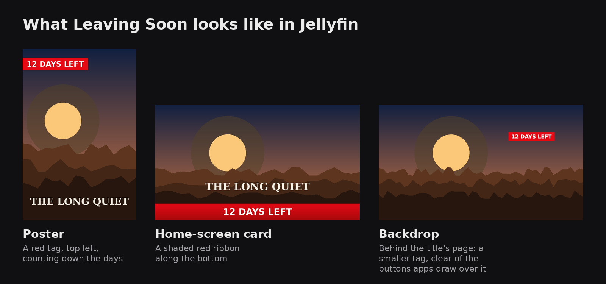
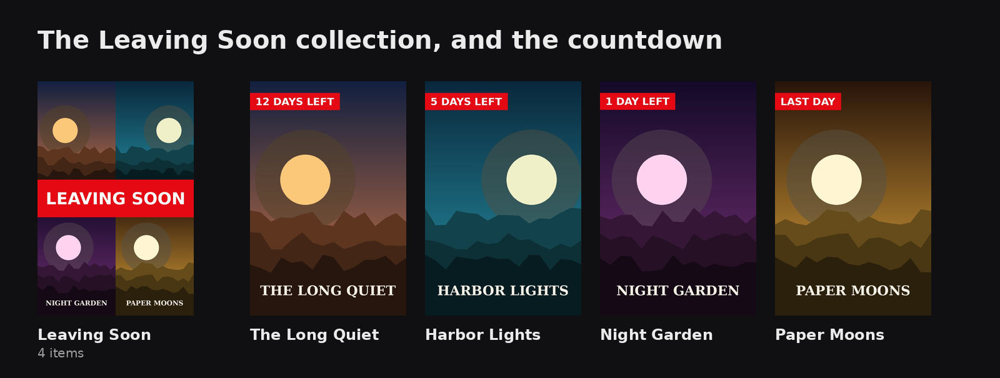

# How Curatarr works

- [Signing in and who sees what](#signing-in-and-who-sees-what)
- [Keeping the right things on disk](#keeping-the-right-things-on-disk): retention and acquisition
- [Policies](#policies)
- [Chapters and subtitles](#chapters-and-subtitles)
- [Recaps, previews and skip markers](#recaps-previews-and-skip-markers)
- [English dubs](#english-dubs)
- [Continue Watching and what's next](#continue-watching-and-whats-next)
- [Problems: burned-in subtitles and broken files](#problems-burned-in-subtitles-and-broken-files)
- [Search what was said](#search-what-was-said)
- [Collections and suggestions](#collections-and-suggestions)
- [Custom posters](#custom-posters): for everyone or chosen accounts, favourite ribbons, and prompts for an AI
- [Fun facts](#fun-facts)
- [Sharing the machine with playback](#sharing-the-machine-with-playback)
- [Playing smoothly on every device](#playing-smoothly-on-every-device): audio every device plays, seeking on Roku

The interface groups daily decisions under **Overview** and **Review**, title browsing under **Library**, and file improvements under **Enhance**, and administrator controls under **Activity** and **Settings**. The theme button in the header switches between dark and light for that browser.

---

## Signing in and who sees what

Sign in with a Jellyfin account that has the **Administrator** permission, or with an enabled non-admin account that an administrator has allowed in Curatarr. Curatarr checks the password with Jellyfin, ends the Jellyfin session it created, and keeps only the user's ID, name, role and verification time in a signed session cookie that lasts up to seven days. Passwords and Jellyfin user tokens are never stored.

- Every five minutes Curatarr re-checks the account using its own Jellyfin API key, so a removed, disabled or role-changed account loses access. If Jellyfin is unreachable, an existing session continues for up to one hour after its last successful check.
- After five failed sign-ins from one address within 15 minutes, further attempts are refused until the window passes.
- On first run, the sign-in page also asks for the Jellyfin server URL and binds Curatarr to it. Until that first administrator signs in, anyone who can reach the page could bind a different server, so keep Curatarr on a trusted network until setup is done, or set `CURATARR_JELLYFIN_URL` so the server is fixed from the start.

**Household access.** Administrators can enable specific non-admin Jellyfin users in Settings → Integrations → Household access. Those users can browse managed titles, search what was said, and choose **Keep**, **Snooze** or **Never Purge** in Review. They can't approve deletion, change rules or integrations, run discovery, reset or request a show, or see full History and Operations. Curatarr rechecks their Jellyfin account periodically and ends a household session as soon as its allowlist entry is removed.

`/health`, `/api/v1/status` and the token-protected webhook stay public for dashboards. Every other page and API endpoint requires sign-in, and operational APIs require administrator access (or the read-only API key; see [API](API.md)). Set `CURATARR_ALLOW_UNAUTHENTICATED=true` only when another layer, such as an authenticating reverse proxy, already restricts access: it grants the full admin interface.

Integration keys and the webhook token are encrypted in the database with a key derived from `CURATARR_SECRET_KEY`. Losing or changing that key makes them unreadable, so back up the key together with the database. Curatarr needs no media access for library management: deletion always goes through Sonarr or Radarr.

---

## Keeping the right things on disk

### Cleanup is driven by free space

Titles nobody has played are not removed just for being unwatched. (A library can opt into that with *Clean up unwatched titles even when space is fine*.) When free space falls below a library's **low** threshold, Curatarr picks titles in purge-strategy order (longest unwatched first by default), and only enough to get back to the threshold.

1. They show as **Leaving Soon** for the notice period (14 days by default), with a red tag in the top-left corner of their poster in Jellyfin that counts down the days left ("14 DAYS LEFT" … "LAST DAY"). The wide home-screen card gets a shaded red ribbon with the same words, and the backdrop behind the title's page a small tag on its right, below where apps put their header buttons. Curatarr also keeps a "Leaving Soon" collection in Jellyfin with exactly those titles (Settings → Household), with a poster of four of them under a red LEAVING SOON band. Overview gives them a small card of their own (how many, how much space, and when the first goes, linking to Review) rather than listing them under Needs you, since nothing is needed: they go unless someone watches. Playing any of it, or Keep, puts the original pictures back within about 15 seconds (Jellyfin apps may show their cached copy a little longer). If the artwork is replaced meanwhile (a metadata refresh, or a poster someone uploads by hand), the banner is drawn again on the new poster within a minute or so, and that poster is the one restored if the title is kept: a custom poster isn't swapped back for the old one.

   With the **Curatarr plugin for Jellyfin** installed (Settings → **Install in Jellyfin** does it, and sets it up; see [jellyfin-plugin](../jellyfin-plugin/README.md)), Delete in any Jellyfin app marks a film or show Leaving Soon instead of deleting its files, so it leaves through Radarr or Sonarr like everything else, and can still be saved; deleting it again deletes it now (through Radarr or Sonarr). In Jellyfin's web app the menu has **Leaving Soon** beside **Delete**, which deletes straight away (this needs the File Transformation plugin; other apps build their menus themselves). A title Curatarr has to keep (Never Purge) makes the delete fail. Episodes, seasons and anything Curatarr doesn't manage are deleted by Jellyfin as usual.

   

   

2. They're removed when the notice ends, unless someone watches them. **Any playback** after a title was marked resets inactivity and rescues it (viewing from before it was marked doesn't count).
3. Below the **critical** threshold, removal happens without a notice.

The default grace period after adding a title is 30 days, and the inactivity period is 90 days. Movie cleanup is retention only: deleted movies are never automatically re-acquired (except seasonal films, below, when you switch that on).

### What the household's choices change

Settings → Household. Each of these shows on a title's page, and in Review, as a short note saying why.

- **Requested.** With Seerr (or Jellyseerr/Overseerr) connected, a title someone asked for isn't cleaned up until that person has played it, for up to 90 days. Declined requests don't count.
- **Rewatched.** A film played twice or more (by one person or several), or a show someone has rewatched three episodes of or two people each follow, goes to the back of the line, like a favourite. Play counts come from Jellyfin.
- **Added by an import list.** Titles Sonarr or Radarr added from a list rather than a person get a shorter grace period (7 days) and go first, until someone plays one. Radarr's lists are recognised from Radarr itself; for Sonarr's, give the list a tag (Sonarr puts it on every show the list adds).
- **Favourites.** A title someone favourited in Jellyfin goes to the back of the line. A gold star with the names of everyone who favourited it shows on its page, in Review, Free up space, Browse titles and Shows by size.
- **Seasonal shelves.** Halloween and Christmas titles, by their TMDB keywords or because they were watched mostly in that season in earlier years, are kept through their season and the two weeks before it. Optionally (off by default), a seasonal film Curatarr removed is added back to Radarr, with its old quality profile and folder, two weeks before its season.

### Shrink instead of delete

A film of 4 GB or more has **Shrink…** in Review and on its page. Curatarr asks Radarr's indexers for a copy **half the size or smaller**, at the same resolution (1080p for anything bigger), that Radarr would accept once the current file is gone. Only if one exists is the current file deleted and that copy downloaded; the film leaves the review queue, and its page shows the swap until the new file arrives. If nothing is small enough it says so, with the date, and changes nothing. When the film's quality profile allows upgrades, it's unmonitored so Radarr doesn't fetch a big copy again; if the small copy hasn't arrived in two days, the film is monitored again and Radarr searches for any copy.

### Disk forecast

Overview shows, for each disk with a path set in the retention rules, how much is free, how fast it's filling (what arrived over the last week) and roughly when it reaches the low free-space mark, with the titles cleanup would take first then. It's updated at each reconciliation and takes the household's choices into account.

### Before anything is deleted

**Dry run is on by default.** In dry run Curatarr goes through the whole process and records what it would remove in History, but never asks Sonarr or Radarr to delete anything. The banner at the top of every page says which libraries are in dry run; turn it off globally or per library.

Before each deletion Curatarr rechecks the mapping, recent activity, grace period, policy, download queue and integration health. If it can't verify these, it doesn't delete. Approving a deletion in Review has its own confirmation page. All decisions and outcomes are written to History.

The review queue offers **Delete**, **Keep**, **Snooze** and **Never Purge**.

### TV: one season ahead

- The default always-keep minimum for a show is the first three episodes of Season 1.
- A completed episode may request missing episodes in that season and the next known season. Requests for a whole season also monitor that season in Sonarr, so episodes announced later are downloaded too.
- Once viewers have watched the latest season (by the acquisition threshold), the next season is requested whenever it appears, without the recent-viewing limit. A show not continued although its next season was already out is treated as abandoned.
- While viewers are on a season that's still airing, Curatarr makes sure Sonarr monitors it even when every episode so far is downloaded.
- A show's title page has **Reset to minimum**, which trims it to its always-keep episodes as if nobody had watched it. The rest are deleted through Sonarr with the usual checks (except the grace period and recent viewing), all seasons are unmonitored, and viewing before the reset no longer drives acquisition. Dry run is respected.
- **Library → Free up space** lists every film and show by what going would free, filtered by type, library, and whether anyone (or one particular person) has watched it, and sorted by size, untouched longest, oldest, or most recently watched. Tick titles and mark them **Leaving Soon**: the poster gets the banner, and if nobody plays any of it during the notice period (14 days by default) a film is deleted through Radarr and a show is trimmed to its always-keep episodes, like Reset to minimum. Playing it or Keep cancels; titles held for a Seerr request or their season can't be marked. The page remembers each person's last choices.
- A film's title page has **Remove this film**, which marks it Leaving Soon on request: the Jellyfin poster gets the badge, and it's deleted through Radarr after the notice period (or when you approve it) unless someone plays it or you choose Keep. The usual checks apply except the grace period. Dry run is respected.
- **Request now** on a show's page applies these rules immediately. Until the requested episodes arrive (or two days pass) the button gives way to "Requested …, waiting for N episodes".
- **Always-keep episodes that never arrived** (every release failed, or Sonarr unmonitored the show) are listed on Enhance → Problems and Overview. **Search once** monitors just those episodes and searches; the row then shows "Searching…", and after two days either disappears or says the episodes are still missing, with **OK** to stop listing them. **Leave them missing** stops listing them straight away.

---

## Policies

Policy resolves **title override → library → global → built-in default**. The Acquisition and Retention pages edit global defaults or any one library, and show each effective value with where it comes from.

- Every setting, including library-size limits, free-space enforcement and dry run, can be set globally or per library.
- Library-size limits apply to each library separately. Free space is measured per disk and shared by every library on it.
- A global change is rejected if it would leave any library with an invalid effective policy.
- **Review mode** can be set per library and per cleanup rule: inactivity, quota, and low/critical disk pressure each have their own mode, which inherits the library's when left blank. So one rule can run automatically while the others still require review. A title-level review mode overrides all rule modes.
- Title overrides include Never Purge, thresholds, minimum footprint and review behaviour.
- Quota rules require high-water bytes strictly above low-water bytes.
- Disk-pressure rules need an explicit path **as Sonarr or Radarr sees it**. When that path can't be matched to a reported volume, Curatarr doesn't select media on disk pressure alone.

---

## Chapters and subtitles

Optional, and off until you enable it per library in **Settings → Enhance**.

After Sonarr or Radarr finish importing a movie or episode of at least 20 minutes that has no chapters, Curatarr adds them:

- **Navigation Chapters** places one about every 7 minutes (4–10 minutes apart), moved to the nearest scene change.
- **Smart Chapters** also transcribes the audio locally with faster-whisper, asks an Ollama model where the story moves on and what to call each chapter, and falls back to Navigation Chapters if that fails.

Chapters are written into MKV files in place with `mkvpropedit`, which re-encodes nothing; other containers are reported as unsupported. Every file is verified afterwards, and only that item is refreshed in Jellyfin.

- **Existing chapters are preserved.** Curatarr regenerates or removes only chapters it can show it wrote, and keeps the originals of any it replaced.
- **Your existing library is never processed by surprise.** Enhance → Files scans it read-only, shows what's done and what's left, and processes only the files or libraries you confirm. Each file's page shows a preview: the scene changes, the plan from each method, and the exact write command, before anything is modified.
- **Subtitles.** The same transcript can produce English subtitles (`<video>.en.Curatarr.srt`), a separate per-library setting. They're added only when a file has no English subtitles of its own, never written over another file, and removable from the file's page. English subtitles that are only pictures (Blu-ray PGS, DVD VobSub) don't count, by default: TV apps such as Roku can't draw them, so Jellyfin burns them into the video, restarting it and slowing seeking. Those files get a text track beside the picture one (Settings → Enhance → Subtitles, *Also when the English ones are only pictures*); files checked before this are looked at again in the background.
- **Progress.** Enhance → Progress leads with what Curatarr has done (chapters and subtitles added, recaps and previews marked, bad markers hidden) and how much of the library is covered, then what's left to do. **One overall bar**, at the top of Overview and of Enhance's Activity, counts everything still queued (chapter jobs, skip-marker checks, TV-friendly audio, the Roku seek repair) and says when the slowest should finish, from the last day's pace. It says which one that is, and when the estimate is rough (rebuilds wait for Jellyfin's thumbnails). Separate bars for chapter jobs and skip-marker checks sit below it, and Overview's Library care shows the same rows as Enhance.
- **To do buttons say what they'd do**: *Scan N new files* scans only files not scanned yet, *Rescan all files* asks first, and *Generate subtitles for N* and *Check skip markers on N more* show how many they'd add and appear only when there's something to add.

- **Each title's page has an Enhancements panel**: per file (episodes grouped by season), its chapters, generated subtitles, the recap and preview Curatarr marked, skip markers it fixed, and its English-audio check.
- **A network share that drops doesn't fail the queue.** When a file can't be found but Radarr or Sonarr still have it (or can't be reached either), its job waits and retries every ten minutes, failing only after a day. Jobs that failed this way are retried by themselves once the file can be read again, and Progress's Failed list has **Try all again**.

Smart Chapters needs the `chapters` or `chapters-gpu` extra, Ollama with a model, and write access to the media files for the worker (see [Installing](INSTALL.md#optional-chapter-generation)). `flask --app curatarr chapters preview <file>` prints the full analysis for one file without changing it. Design notes: [decision 009](decisions/009-chapter-enrichment.md).

---

## Recaps, previews and skip markers

With the Jellyfin **Intro Skipper** plugin installed, Curatarr improves the skip buttons Jellyfin shows. It works on episodes in libraries with Smart Chapters. Press **Check skip markers** on Enhance → Progress to check every episode not yet checked (press it again later for newly added ones), or check one episode from its page. Checks reuse Smart Chapters transcripts where they exist. One job slot is always theirs, and they take any slots chapter jobs leave free, a batch of episodes each; checks that need new transcription wait while a chapter backlog is running.

- **Recaps.** A *"Previously on…"* segment is found from the opening transcript: a known opener phrase ("previously on", "last time on", "here's what you missed", …), and an end found from the series' own closing line or from where the quoted clips of earlier episodes stop. It's marked as an Intro Skipper **Recap** segment and, if the chapters are Curatarr's, a *Previously On* chapter.
- **Previews.** A *"Next time on…"* segment at the end is marked as a **Preview** segment.
- **Bad markers hidden.** Intro Skipper sometimes guesses wrong: a short "credits" marker with lots of dialogue after it, credits in the first quarter of an episode, an "intro" that's mostly unique dialogue. Curatarr hides those, recording why.
- **Movies keep only their credits marker** (on by default). Opening chapter names like "Chapter 1" made Intro Skipper mark recaps and intros at the start of movies; they're hidden. Credits stay, for *Skip Credits* and *Next*.

- **Wrong episodes** (off by default: Settings → Enhance, *Check episodes against their summaries*). An episode whose transcript fits another episode's summary far better than its own, or whose default audio isn't English, is flagged on **Enhance → Wrong episodes** and Overview, to fix in Sonarr, **Make English the default** where the file has an English track, or dismiss.

Everything is listed on **Enhance → Skip markers**, newest first, with the span, the reason and a link to the episode, and each change has **Undo**.

Jellyfin decides per user whether to show a Skip button for each segment type (Settings → Playback → Media segments). Some clients, such as the Roku app, keep their own per-device setting.

---

## English dubs

For households that watch films dubbed rather than subtitled. On by default; settings in Settings → Enhance.

Radarr can grab an English dub of a film made in another language, but uploads are sometimes labelled English when the audio is really the original. For films whose original language (from Radarr) isn't English, and for English films whose file also carries other languages, Curatarr **listens**: five 20-second clips from the middle of the film, per audio track, through Whisper's language identification, with a voice filter so music isn't mistaken for speech. A track's language counts only when most clips agree with high confidence. This is not a transcription, and takes seconds per film.

What it does with the result:

| Found | Action |
|---|---|
| A track whose label is wrong or missing | Relabels it (in place, no re-encode) |
| A real English track that isn't the default, while the default is clearly another language | Makes the English track the default |
| No English audio at all | Lists the film on **English dubs**, to **Replace** (blocklists the release in Radarr, deletes the file and searches again), **Listen again** or **Keep** |
| *Optional:* audio heard clearly in another language, or subtitles labelled in another language | Removes them, once English audio is confirmed |

- **Replace automatically** is on by default (Settings → Automatic): a film with no English audio is replaced once a better copy is confirmed to exist. Dry run is respected.
- **Remove audio and subtitles in other languages** is off by default. The file is rewritten as a copy with `mkvmerge` (never re-encoded), checked (same length, chapters and video, and the expected tracks), and only then moved over the original. MKV only. Tracks it couldn't make out are kept.
- A film's chapter job waits briefly for its dub check, so its transcript comes from the right track the first time.

For Radarr to grab dubs in the first place, its quality profile's language must allow them (*Any*, with a custom format scoring non-English releases down), not *Original*.

---

## Continue Watching and what's next

- **What people watch next is ready first.** Every ten minutes Curatarr asks Jellyfin what each person is in the middle of: the next episode of each show (and the two after it) and films and episodes they stopped partway. Their jobs (chapters, subtitles, skip markers) go to the front of the queue, ahead of the back catalogue.
- **Something stopped in its credits counts as watched** (Settings → Enhance → Skip markers, on by default). Jellyfin marks a film watched only when it's stopped past 90%, so long end credits leave finished films in Continue Watching. Every few minutes Curatarr looks at each person's Continue Watching: anything stopped in its end credits (Intro Skipper's credits marker, in the last quarter), or after its last line of dialogue with at most twelve minutes left (three for an episode), is marked watched for that person, which clears its resume point. The dialogue comes from Curatarr's transcript or an English text subtitle that runs to near the end. Anything still playing, or stopped earlier, is left alone; each one is listed in History.

---

## Problems: burned-in subtitles and broken files

On by default; settings in Settings → Enhance → File problems. A background check goes through every film and episode a few files at a time (films first), stands aside while someone is watching, and looks again only when a file is replaced. It reads a few dozen frames and a few seconds of each file and changes nothing.

| Looks for | How |
|---|---|
| **Subtitles burned into the picture** (films) | Frames from moments of speech and of silence, chosen from the saved transcript (or evenly spaced without one). Subtitles are a line or two of bright, dark-outlined text centred near the bottom, on most speech frames and few silent ones. Title cards, signs and corner captions are too tall, off-centre or don't follow the talking. |
| **Shorter than listed** | The file runs under three quarters of the runtime Radarr or Sonarr gives. |
| **Cut off** | The picture is there halfway through but missing at 80% and 90% of the file's length: an incomplete download. A soundtrack or subtitle track running a little past the picture doesn't count. |
| **Goes quiet** (films) | Nobody speaks after the first 60% of a film that has a transcript. |
| **Decoding errors** | Errors from the video or audio decoder at two or more of six points through the file. |

Problem files are listed on **Enhance → Problems** and on Overview, to **Replace** (blocklist the release in Radarr or Sonarr, delete the file, search again), **Check again** or **Keep**. **Replace problem files automatically** is on by default (Settings → Automatic); dry run is respected. A film that's one part of a split release ("Part.2", "CD1", "Part.II") is flagged as such, and replacing it has Radarr ignore split releases for that film.

### Shows that are another show with the same name

Sonarr sometimes grabs a namesake: a remake, or a foreign show with the same title. A show is flagged when most of its files' names carry a year that isn't the show's (title years and air years excepted), or most of its audio is in another language and no file has an English or original-language track. **Replace** blocklists those releases, deletes the files, searches again and adds a Sonarr release profile, for that show only, ignoring the wrong year. **It's right** stops listing it until its files change.

### Episodes filed under the wrong episode

A release numbered one way and read another (scene numbering applied to a release already numbered the TVDB way, a special counted into the season) lands on another episode's slot, and Sonarr renames it to match. Every half hour Curatarr looks at the last two weeks of Sonarr's imports for files whose download name carries another episode's title. It then compares what's said in the file (its transcript, from chapter, skip-marker or subtitle work) with every episode's title and summary. When both clues point at the same episode, the file is moved there in Sonarr and renamed, and the episode it was filed under is searched for again (or unmonitored, when the show uses scene numbering and a search would bring the same mix-up back). If that episode already has a file, it has to be shown to be the same episode before the worse copy is deleted; a file there that is itself waiting to move goes first, so a whole season shifted by one slot is put right one episode at a time. When what's said fits where the file is filed, the name was wrong and nothing is listed. Anything less certain is on Problems, with Move, Delete this copy and It's right.

### Automatic fixes

Settings → Automatic lists the fixes Curatarr starts by itself instead of listing them: replacing problem files, films with no English audio, and files of another show with the same name, searching once for always-keep episodes that never arrived, and moving episodes Sonarr filed under the wrong episode. All are on by default, since each acts only when it can be confident (a better copy is checked to exist first, or two independent clues agree); each can be switched off. Each fix is tried once, including for problems found before it was switched on. When it doesn't work (no better copy exists, or the episodes are still missing two days after the search), the item is dropped and Activity records that it couldn't be fixed; a Replace you clicked yourself still says "No better copy" and waits for your OK. Overview shows one line, "Handled in the last 7 days", instead of a row per item. Libraries in dry run never replace files.

### Replace checks first

Every **Replace** (English dubs, Problems, wrong shows, and automatic replacement) is queued rather than done on the spot. The worker asks Radarr or Sonarr for the title's releases (a minute or two, across every indexer) and replaces the file only if one would be taken once the current file is gone: not the release already there, not one more part of a split film, and for a wrong show not the wrong year or the flagged releases. Otherwise the file stays.

A film replaced this way is monitored in Radarr until its new copy arrives. If nothing is downloading, it's searched again every 6 hours, up to 3 times. When a copy arrives, monitoring goes back to how it was; when none does, Activity says so.

The row shows where the request is: "Looking for a better copy…" with **Cancel**; then either the row disappears (replaced; History has the details) or it says "No better copy was available, checked <date>" with **OK**, which stops listing it.

---

## Search what was said

**Search** (the box in the header, or Library → Search) (and `GET /api/v1/transcripts/search?q=…`) finds an episode or film by a line or what's talked about in it, across every transcript Smart Chapters has made. An exact phrase ranks first, then short windows holding most of the words; each result shows the moment's lines and timestamp, linked to the episode. Words are matched by rough stem ("frying" finds "fry"). Put words in "quotes" for an exact phrase, said as written (whole words, in order). What was searched is highlighted in each result. Household accounts can use it too.

---

## Collections and suggestions

**Library → Collections** (administrators) lists the film series you have part of, from Radarr's collections (TMDB's film series), nearly complete ones first: "You have 5 of 6". The missing films are ticked ready to add; films not yet released are listed as coming. **Add ticked** adds them to Radarr with the quality profile and root folder of the series' films already in the library, and starts a search. **Follow series** turns on Radarr's own collection monitoring, so the series' missing films and later ones are added as they're released. **Not interested** hides a series for good.

Below, **Suggested for you** takes Radarr's recommendations (films TMDB links to ones in the library), drops anything already there, unreleased or hidden, and ranks the rest by rating and by how well their genres match the films the household has favourited in Jellyfin. Tick and add, or hide a film with **Not for us**.

**Posters in your language** (Settings → Household, on by default): Jellyfin takes a title's poster when it arrives, and a new release often has only foreign posters on TMDB at first, so it keeps a Chinese or Persian one even after an English one appears. Once a day Curatarr compares the poster of each film and show released in the last year with the ones TMDB offers. When it's one in another language and there's one in Jellyfin's metadata language now, Jellyfin is told to use that one. Posters that match none of TMDB's (chosen by hand, or from another source) and Leaving Soon posters are left alone; a title with no poster in the metadata language yet is looked at again every few days. A plugin that rotates posters will undo this.

---

## Custom posters

Your own picture as a title's poster: for everyone, or for chosen accounts only, with the original always kept. **Library → Posters** (administrators) has the import folder, the AI prompt writer and every custom poster; a title's page has a **Poster** panel.

### Putting one on

- **Upload** on a title's Poster panel: a JPEG, PNG or WebP up to 25 MB (portrait 2:3 works best). The picture shows in the panel as soon as it's picked, before anything is sent.
- **Import folder.** Every couple of minutes Curatarr looks in a folder you name for new pictures and matches each file's name to a title: `The Big Lebowski (1998).jpg`, `the-big-lebowski-1998.png` and `08_the-big-lebowski.jpg` (a leading number is ignored) all work. The year is needed only when titles share a name, and a year either side counts, since sources differ by one. A file saved again later replaces the poster it put on (make it again under the same name to redo one), and files that couldn't be matched are listed with the reason. The folder must be readable by Curatarr's worker.

### For everyone, or for chosen accounts

Jellyfin has one poster per title for every account. A custom poster can be that poster, or, with the [Curatarr plugin for Jellyfin](../jellyfin-plugin/README.md) (0.4.0.0 or later), belong to chosen accounts only: they see it in every app (web, phone, TV, Roku), and everyone else sees the usual poster. Choose *Only for* an account when uploading, or tick accounts under **Imported posters are for** to make every imported picture theirs. Where an imported picture was everyone's poster before, everyone else gets the usual one back. Changing which accounts looks at every picture in the folder again.

How it works: apps fetch a poster from an address with a tag in it, taken from the item details they were sent. The plugin puts a tag standing for the account's poster in what's sent to that account (the title itself, and a show's poster on its episodes' cards), and when an app asks for an image with that tag, it serves that poster, resized and cached by Jellyfin like its own. It reads the list from Curatarr every minute (`/api/v1/jellyfin/posters`, with the webhook token).

### Restoring

Before the first custom poster goes on for everyone, the poster it replaces is saved (during Leaving Soon, the one from before the banner), and **Restore original** puts it back. A picture that was already the title's poster when imported is recorded without uploading it again; restoring it takes the metadata provider's poster. An account's own poster is simply removed. On Library → Posters each picture is one tile, listing everyone it's for, with a **Remove** for each and **Remove for all**. During Leaving Soon the countdown is drawn on the custom poster, an account's own included (its tag changes with the banner's words, so apps fetch it again as the days count down), and the custom poster is what's restored if the title is kept. History records each one.

### Favourite ribbons

A gold tag on a title's poster saying whose favourite it is ("★ Sam", or "★ Sam + 1" when several people favourited it), so one account sees what another loves, in every Jellyfin app. Off by default; set it up on Library → Posters under **Favourite ribbons**: whose favourites everyone sees (one tick per account), or account by account under *Choose account by account* (a grid, so one can see another's and not the reverse), whether accounts see their own marked (off), along the bottom (the default) or top right, and names or just a star. A preview shows how it looks.

It needs the Curatarr plugin for Jellyfin (0.4.0.0 or later) and works like posters for one account: the plugin shows each account its version of the poster, drawn over the one it would see anyway (Jellyfin's poster with any Leaving Soon countdown, which sits top left, or the account's own custom poster). Favourites come from Jellyfin, so a new one gets its ribbon at the next reconciliation. The first time it's switched on, the plugin downloads each marked poster once (a few minutes for a few hundred), and again only when the poster, the countdown or the ribbon changes.

### Make them with an AI

The Posters page writes prompts for an image-making AI agent that can read and save files (Codex, for example). Choose the titles (anyone's or one account's favourites, every film or every TV show, skipping those that have a custom poster), how many per batch, and optionally a folder of reference photos and who's in them, to cast as the lead characters where a story suits it. Each batch's prompt lists its titles with year, genres, plot and the file name to save, and says to save into the import folder, where Curatarr puts them on as they arrive, for the accounts you chose. The photos are read by the agent, never by Curatarr; only use photos of people who've agreed, and if the agent is a cloud service, they're sent there.

---

## Fun facts

**Library → Fun facts** (everyone, household accounts included) ranks films and shows by what's said in them, from the Smart Chapters transcripts. Every figure is a rate (per hour or per minute), so a show with hundreds of episodes doesn't win by size: swearing and f-bombs, squeaky-clean talkative films and the shows that swear least (handy for picking something for the kids), kill-and-blood talk, "help!" and "run!", the chattiest and quietest, "I love you", pleases and thank-yous, questions, shouting, the biggest vocabularies, the longest wait for the first word, the longest silence and the longest stretch of non-stop talk. **Who gets talked about** lists the names said most per hour. **Catchphrases** gives each show's longest phrase that recurs across its episodes (never the show's own name), shows people watch first. Theme songs, transcripts in other languages and generic phrases are left out. Each transcript is counted once in the background, with no GPU, and the page grows as more files are transcribed. Every title links to Jellyfin.

---

## Sharing the machine with playback

**Pause all work** (Enhance → Progress) is for when you need the machine for something else: for an hour, four hours or until you resume. Running jobs are stopped and put back in the queue (they start over on resume), nothing new starts (chapters, subtitles, skip-marker, dub and file checks, transcription), and the language model is unloaded from the graphics card. A banner on every page says until when, with **Resume now**.

Chapter work is heavy (scene detection, transcription, a language model), and the same server usually streams to the household. Curatarr adapts how many chapter jobs run, every worker cycle:

- It measures CPU use, GPU use (counted only while Jellyfin is transcoding), how many people are watching, and how many of those streams are transcoded.
- With nobody watching it aims to keep the machine under 85%. Each viewer lowers that by 15 points and each transcode by another 15, never below 35%.
- Below the target it adds a job, one a minute. Above it, nothing new starts and running jobs finish.
- With **Make room for people watching** on, if someone is watching and the machine stays well over the target for 30 seconds, running jobs are suspended for at least two minutes and resume once there's room.
- While Jellyfin transcodes, the graphics card's video decoder is left to it: Curatarr's scene detection decodes on the processor instead, and the decoder's load isn't counted (Jellyfin's own streams can keep it near 100%, which pausing Curatarr wouldn't change). The graphics card's compute, which transcription uses, still counts.

**Chapter jobs at once** (1–8) is only the ceiling. The Activity card on Enhance → Progress says what was measured and decided, for example *Up to 3 chapter jobs right now · CPU 42%, 1 watching (aiming under 70%)*.

---

## Playing smoothly on every device

Transcoding (converting while you watch) loads the server and is what makes some players stall or loop. Most of it comes from audio a device can't play, which is cheap to fix without touching the picture.

- **Each device plays the copy and audio track it can play as it is** (with the [Curatarr plugin for Jellyfin](../jellyfin-plugin/README.md)). Jellyfin plays a title's default track and first copy whatever the device can decode. The plugin asks Jellyfin's own stream builder, with the device's profile, how each copy and each same-language audio track would play, and points the player at the one needing the least work. Commentaries, other languages and anything picked by hand are left alone.
- **Stereo AAC tracks for web browsers** (Settings → Enhance, on by default, with the Curatarr plugin for Jellyfin). Chrome and Firefox can't play AC3, E-AC3 or DTS, so Jellyfin converts the sound while they watch (half of all transcodes on one server). Curatarr adds a stereo AAC copy of the main track, last and not default, so TVs keep the surround track they play now, and the plugin points browsers at it. Picture and other tracks are copied untouched, the file is checked before it replaces the original, and rebuilds are paced to Jellyfin's thumbnails.
- **TV-friendly audio** (Settings → Enhance, off by default). Rokus, many smart TVs and soundbars can't play DTS, TrueHD or FLAC, so Jellyfin converts it during playback, and some players then get stuck restarting at one spot. For films and episodes whose main audio is one of these, with no AC3, E-AC3 or AAC track in the same language, Curatarr adds an AC3 copy (5.1 at most) as the first, default track and keeps the original beside it. Only that track is encoded; everything else is copied. The copy is checked (same length, chapters, video and subtitles, one more audio track) before it replaces the file. They're found from Radarr's and Sonarr's media info, one or two at a time, never one being played and not in dry-run libraries. MKV only.
- **A commentary or audio description isn't played by default** (Settings → Enhance, on by default). When a file's default audio track is the director's commentary or an audio description (by its flags or its name) and the film's own soundtrack in that language is there, that becomes the default: in place, nothing re-encoded. Every file is looked at once, a few each minute, and again when it's replaced.

### Seeking on Roku

Matroska files carry a seek head that says where the seek index is. When an in-place edit (Curatarr's chapters, a track's language or default flag) doesn't fit at the start of the file, mkvpropedit moves the seek head to the end and leaves a stub at the start that only points there. That's valid Matroska, but Roku players don't follow the stub: they can't find the index, so jumping ahead starts the video over.

Curatarr checks the file after every edit and, if the index is out of reach, rebuilds the file with mkvmerge: every track, chapter, tag and attachment is copied as it is, the copy is checked against the original, and only then replaces it. **Seeking on Roku** (Settings → Enhance, on by default) does the same for files already affected: it reads the start of each MKV once (again only if the file changes), titles being watched first, and rebuilds one or two files per worker cycle, never one that's playing. Enhance shows how many files were checked and repaired.

### Jellyfin thumbnails

Adding TV-friendly audio, repairing seeking and removing other languages each rebuild the file (the picture is copied untouched). Jellyfin can't tell, so it drops that title's scrubbing thumbnails (trickplay) and makes them again, one file at a time, a few minutes each. **Jellyfin thumbnails** (Settings → Enhance, on by default) keeps Curatarr from getting ahead of it: another rebuild starts only while fewer than three rebuilt files that had thumbnails are still waiting for new ones. Files that had none (or whose library has thumbnails off) don't count, and a file waits at most two days. Enhance says when rebuilds are waiting.
